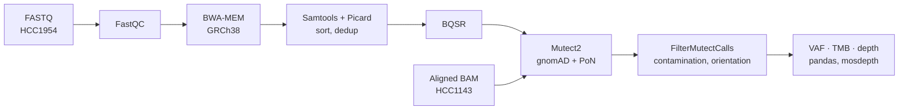

<picture>
  <source media="(prefers-color-scheme: dark)" srcset="assets/visual-abstract-dark.svg">
  
</picture>

<h1 align="center">Cancer Genomics Somatic SNV Pipeline</h1>

<p align="center">
  An automated, containerized GATK Best Practices workflow that finds tumor-only mutations in paired tumor and normal breast cancer exomes
</p>

<p align="center">
  
  
  
  
  
  
</p>

<p align="center">
  <a href="#overview">Overview</a> &nbsp;·&nbsp; <a href="#results">Results</a> &nbsp;·&nbsp; <a href="#pipeline-workflow">Workflow</a> &nbsp;·&nbsp; <a href="#data-sources">Data</a> &nbsp;·&nbsp; <a href="#how-to-run">How to run</a>
</p>

---

## At a glance

| **2** | **102** | **GRCh38** | **≤ 2.2%** | **1** |
|:---:|:---:|:---:|:---:|:---:|
| tumor / normal pairs | PASS somatic mutations (chr17) | reference build | estimated contamination | command to rerun everything |

> **Take-home:** one Snakemake command takes a tumor and normal pair from raw reads to a filtered somatic VCF and then reports VAF, TMB and coverage. As a result, any new pair can follow the same reproducible, containerized path.

## Skills demonstrated

| Area | Evidence in this repository |
|---|---|
| **NGS processing** | FastQC quality control, BWA-MEM alignment to GRCh38, Samtools sorting and indexing, Picard duplicate marking |
| **Somatic variant calling** | GATK Mutect2 with gnomAD and a 1000 Genomes panel of normals, read-orientation modeling and FilterMutectCalls |
| **Quality control** | Cross-sample contamination with GetPileupSummaries and CalculateContamination, base quality recalibration, mosdepth coverage |
| **Workflow automation** | Snakemake rules for a single pair, then a scaled multi-pair workflow that starts from FASTQ or from aligned BAM |
| **Reproducibility** | Docker image and a pinned Bioconda environment, run under WSL2 |
| **Data analysis** | Python and pandas for variant allele frequency, tumor mutational burden and coverage summaries |

## Overview

Cancer is driven by somatic mutations, which are DNA changes present only in tumor cells and absent from the patient's healthy tissue. This project identifies those mutations by comparing tumor and matched-normal whole-exome sequencing data with an industry-standard workflow: quality control, alignment, duplicate marking, base quality recalibration and somatic variant calling with GATK Mutect2. Furthermore, the pipeline is fully automated with Snakemake and packaged with Docker, so it runs the same way on any machine.

The data come from breast cancer, specifically two tumor and normal pairs from the well-characterized HCC1143 and HCC1954 cell lines. The project combines two complementary workflows:

- **Project 1, automated somatic SNV pipeline:** raw FASTQ to aligned BAM to filtered somatic VCF, using BWA-MEM, Samtools, Picard and GATK Mutect2, orchestrated end to end with Snakemake.
- **Project 2, containerized multi-sample QC engine:** the same pipeline scaled to several tumor and normal pairs, which then computes clinically relevant metrics (variant allele frequency, tumor mutational burden and coverage depth) inside a Docker container for one-command reproducibility.

**Goal:** build a reproducible cancer genomics workflow that mirrors the precision-oncology pipelines used in clinical and research settings.

## Results

Mutect2 was run on chromosome 17 for both pairs, which keeps the run within laptop memory. The summary below comes directly from `cancer_genomics_pipeline_report.ipynb` and the files in `results/`.

| Pair | Starting point | PASS somatic mutations | Median VAF | TMB per Mb | Contamination |
|---|---|:---:|:---:|:---:|:---:|
| HCC1143 | aligned BAM | 26 | 0.261 | 0.68 | 2.2% |
| HCC1954 | raw FASTQ | 76 | 0.184 | 2.00 | 0.6% |

**How to read these numbers.** Both pairs show low cross-sample contamination, so the PASS calls are not driven by sample mixing. In contrast, TMB here divides PASS mutations by an assumed exome size rather than the exact capture-kit regions, and it counts only chromosome 17, so it is illustrative rather than clinical. Similarly, the two pairs entered the pipeline at different points (FASTQ versus BAM), so direct comparisons between them should be made with care.

## Pipeline workflow

1. **Quality control:** FastQC on raw reads
2. **Alignment:** BWA-MEM against GRCh38
3. **Post-processing:** Samtools sort and index, Picard duplicate marking
4. **Base quality recalibration:** GATK BaseRecalibrator and ApplyBQSR
5. **Somatic variant calling:** GATK Mutect2 with a panel of normals and gnomAD germline filtering
6. **Contamination check and filtering:** GetPileupSummaries, CalculateContamination (ExAC common sites), read-orientation model and FilterMutectCalls
7. **QC metrics:** VAF, TMB and coverage depth with mosdepth and pandas
8. **Workflow automation:** Snakemake orchestrates every step end to end
9. **Containerization:** a Docker image reproduces the full environment



## Data sources

All input data is public:

- **HCC1143 / HCC1143BL** (pre-aligned BAM): [GATK Best Practices somatic-hg38 public bucket](https://console.cloud.google.com/storage/browser/gatk-best-practices/somatic-hg38)
- **HCC1954 / HCC1954BL** (raw FASTQ): [10x Genomics public WES datasets](https://www.10xgenomics.com/)
- **Reference genome GRCh38 and resource files** (panel of normals, gnomAD, ExAC common variants): [Broad Institute public reference bucket](https://console.cloud.google.com/storage/browser/gcp-public-data--broad-references/hg38/v0)

## Repository structure

```
├── Snakefile                              # Single-pair pipeline rules
├── Snakefile_multi                        # Multi-pair scaled pipeline
├── config.yaml / config_multi.yaml        # Pipeline configuration
├── Dockerfile                             # Container build specification
├── environment.yml                        # Conda environment definition
├── cancer_genomics_pipeline_report.ipynb  # Full documented walkthrough
├── results/                               # Filtered VCFs, contamination tables, coverage, QC
└── assets/                                # Visual abstract (light and dark)
```

## Environment and reproducibility notes

This pipeline was developed and executed in WSL2 with a Conda (Bioconda) environment, since the specialized tools (BWA, Samtools, GATK4, Snakemake) require Linux. The included `Dockerfile` and `environment.yml` define the exact reproducible environment. Owing to local hardware constraints, the Docker image build and run were validated conceptually and documented in detail rather than executed end to end on this machine; nevertheless, the container is designed to run identically on any system with Docker installed.

## Limitations

- **Cell lines, not patient tumors.** HCC1143 and HCC1954 are cleaner and more uniform than real patient samples, so the results demonstrate the method rather than clinical findings.
- **Two pairs only.** The comparisons illustrate the workflow and are not statistically meaningful biology.
- **Simplified metrics.** TMB uses an assumed exome size, and coverage depth is genome-wide unless a target exon BED file is supplied.
- **Recalibration resources.** BQSR used gnomAD known sites; adding dbSNP and Mills indels would refine it further.

## How to run

```bash
# Create environment
conda create -y -n cancergenomics -c conda-forge -c bioconda \
  python=3.10 bwa samtools htslib gatk4 snakemake-minimal picard fastqc mosdepth pandas matplotlib
conda activate cancergenomics

# Run the single-pair pipeline
snakemake --cores 4

# Run both pairs with the scaled workflow
snakemake -s Snakefile_multi --cores 4

# Or via Docker (recommended for full reproducibility)
docker build -t cancer-genomics-pipeline .
docker run -v $(pwd)/results:/app/results cancer-genomics-pipeline
```

## License

Released under the [MIT License](LICENSE).
